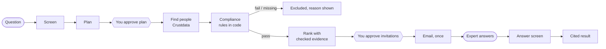

<div align="center">

# 🧭 S Y N E X

### GLG, rebuilt as software.

*Ask a business question. Get cited answers from compliance-cleared former insiders. No calls to schedule.*


</div>

---

## 🎬 Main video

<div align="center">

[](https://youtu.be/cN9uOZELZJ4)

**▶ [Watch on YouTube](https://youtu.be/cN9uOZELZJ4)**

</div>

## 🖥️ Live walkthrough

<div align="center">

[](https://www.youtube.com/watch?v=p9qn2XVP5Eg)

**▶ [Watch on YouTube](https://www.youtube.com/watch?v=p9qn2XVP5Eg)**

</div>

---

## ⚡ The idea

Expert networks (GLG, AlphaSights, Guidepoint) charge by the call hour to connect you with former insiders. Synex does the whole job in software:

**question → sourcing → compliance screen → invitations → answers → cited result**

| | |
| --- | --- |
| 🔎 **Finds** | former employees in live Crustdata people data |
| 🛡️ **Screens** | every person and every answer with fixed rules, written in code |
| ✉️ **Invites** | an anonymised panel, only after a human approves |
| 📑 **Delivers** | sources, confidence, and a summary where every sentence cites an answer |
| 🤷 **Admits** | "cannot verify" when the data is missing. It never guesses |

## 🔄 How it works



Eight stages: question screen, plan, sourcing, people screen, ranking, invitations, response screen, result. Details in [`docs/ARCHITECTURE.md`](docs/ARCHITECTURE.md).

## 🧱 What makes it trustworthy

- **Rules in code, not prompts.** Each decision names the Crustdata field, value and record date it used.
- **Models propose, code verifies.** Evidence quotes, redactions and citations are checked in code. Anything unverified is dropped.
- **Humans approve what is irreversible.** The plan, the invitations, and any held answer.
- **Exactly-once email.** An idempotency key survives a `kill -9` mid-send.
- **Everything logged.** A hash-chained audit trail and a cost log for every Crustdata and model call.
- **Anonymous to the customer.** No names, links, cities or emails.

## 🧪 Honest limits

- **Teammates play the experts.** Mail goes only to a two-address allowlist through a local Mailpit inbox, never to a real person.
- **No payments.** The case page shows a quoted price in rupees, labelled "no payment taken".
- **Free hosting.** On Render's free plan a redeploy or idle sleep empties the database.
- **Not built:** the closed-period rule, a do-not-contact table, voice interviews and period validity.

## 🚀 Run it

Needs Python 3, [uv](https://github.com/astral-sh/uv), Node 20+, and [Mailpit](https://github.com/axllent/mailpit).

```bash
cp .env.example .env     # add CRUSTDATA_API_KEY and SYNEX_ANTHROPIC_KEY
cd server && uv venv .venv && uv pip install -r requirements.txt --python .venv/bin/python
SYNEX_DEV_CACHE=1 .venv/bin/uvicorn app.main:app --port 8000
mailpit                                      # inbox at http://localhost:8025
cd ../web && npm install && npm run dev      # http://localhost:3000
```

Use `SYNEX_DEMO=1` for the demo (no cache, no limits). Never set `ANTHROPIC_API_KEY`.

```bash
cd server && .venv/bin/python -m pytest -q   # tests, no network, no spend
server/scripts/kill_test.sh                  # kill mid-send, one email per invitation
```

## 🗂️ Repo

```
server/     FastAPI: stages 1 to 8, compliance rules, mail gate, audit chain, PDF report
web/        Next.js: customer, operator and expert screens
contracts/  agreed API, event and enum definitions (append-only)
docs/       architecture, plan, progress logs
```

## 🙏 Credits

**Backend:** [FastAPI](https://github.com/fastapi/fastapi), [Uvicorn](https://github.com/encode/uvicorn), [httpx](https://github.com/encode/httpx), [pydantic](https://github.com/pydantic/pydantic), [pytest](https://github.com/pytest-dev/pytest), [ReportLab](https://github.com/MrBitBucket/reportlab-mirror), [pypdf](https://github.com/py-pdf/pypdf), [Anthropic Python SDK](https://github.com/anthropics/anthropic-sdk-python), [uv](https://github.com/astral-sh/uv).
**Frontend:** [Next.js](https://github.com/vercel/next.js), [React](https://github.com/facebook/react), [Tailwind CSS](https://github.com/tailwindlabs/tailwindcss), [TypeScript](https://github.com/microsoft/TypeScript), [ESLint](https://github.com/eslint/eslint).
**Fonts (SIL OFL):** Geist, Geist Mono, Instrument Serif, [IBM Plex](https://github.com/IBM/plex).
**Tools and data:** [Mailpit](https://github.com/axllent/mailpit) (MIT), [Crustdata](https://crustdata.com), [Anthropic](https://www.anthropic.com).

**Scaffolding commands run:**

```bash
npx --yes create-next-app@latest web --ts --tailwind --eslint --app --src-dir --import-alias "@/*" --use-npm --no-turbopack --disable-git --yes
uv venv .venv
uv pip install -r requirements.txt --python .venv/bin/python
```

Built from empty folders at ContextCon 05 by Dev and Ananya, with Claude Code. Commit history is unedited. The landing-page pond is drawn in code and inspired by pixel-art koi ponds; no art or code was copied.

<div align="center">

**Synex** · *Services, Replaced*

</div>
