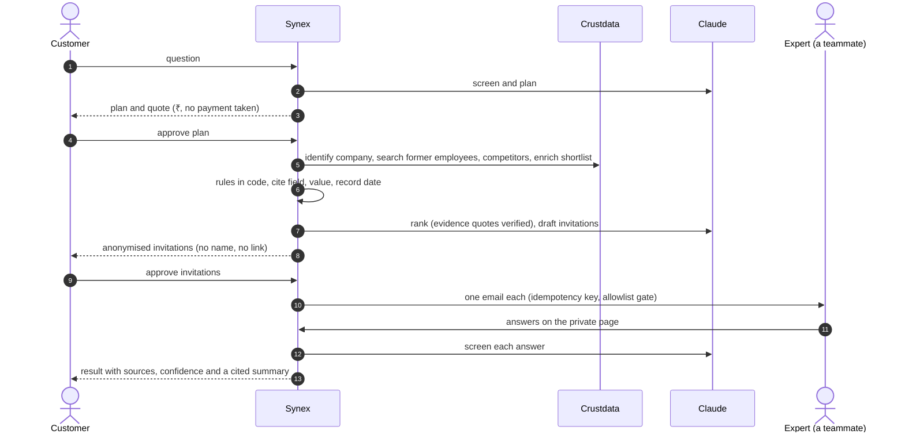

# Synex

An expert network, rebuilt as software. A customer asks a business question. Synex finds former employees in live people data, screens every person and every answer with fixed compliance rules, invites a panel by email (to teammates only, in this competition), collects their answers, and returns them with a count of independent sources, a confidence level and a short summary where every sentence cites an answer.

Built at ContextCon 05 (theme "Services, Replaced") by Dev and Ananya.

## 1. The service

**The job and who pays for it today.** Expert networks (GLG, AlphaSights, Guidepoint, Tegus) are paid by hedge funds, private-equity firms, consultancies and corporate strategy teams to find a former employee who can answer a question, check that talking to them is allowed, and set up a paid call. The price commonly quoted is about $500 to $1,500 per call hour (a figure from our earlier research, not verified during the build). Synex does the sourcing, the compliance screening, the invitations, the answer screening and the write-up.

**Input.** One business question in plain text, on the Ask page or `POST /cases {"question": "..."}`. The customer then approves the plan and the panel size, and later the anonymised invitations.

**Finished result.** Per sub-question: the anonymised panel that passed the compliance rules; the screened answers (accepted, or redacted with the risky part removed); the number of independent sources; a confidence level computed in code (High with 3 or more independent sources, Medium with 2, Low with 1); and a summary in which every sentence cites an answer, with uncited sentences dropped in code. Every screening decision names the Crustdata field it read (for example `experience.employment_details.past[2].end_date`), the value, the record's refresh date and the call id. Where the sources do not settle a question the result says **cannot verify** and names what is missing. The audit trail and the cost log come with it.

**Price and measured cost.** The case page shows a quoted price in rupees (₹8,000 per answered sub-question, set by `SYNEX_PRICE_PER_SUBQUESTION_INR`), labelled "quoted price, no payment taken": this build takes no payment. It also shows the measured cost of the job, from the cost log: Crustdata credits and model spend in dollars and rupees (`SYNEX_USD_INR`, default 85; `SYNEX_INR_PER_CREDIT` converts credits once the team sets the rate it pays). A demo-mode case with 5 sub-questions used about 170 Crustdata credits and $0.28 of model spend.

### At a glance

| | |
| --- | --- |
| **Replaces** | an expert-network call (GLG, AlphaSights, Guidepoint) |
| **Input** | one business question in plain text |
| **Output** | a compliance-cleared anonymous panel, screened answers, sources and confidence per sub-question, a cited summary |
| **Live data** | Crustdata people and company data, Claude Haiku 4.5 |
| **Human clicks** | approve the plan, approve the anonymised invitations, accept or reject a held answer |
| **Never** | contacts a real person, takes a payment, shows a customer a name or a link, guesses when data is missing |

```mermaid
flowchart LR
    Q([Customer asks a question]):::person --> S1[Question screen<br/>allow, refuse or rewrite]
    S1 --> S2[Plan<br/>3 to 5 sub-questions]
    S2 --> A1{{Customer approves<br/>plan and panel size}}:::approve
    A1 --> S3[Find former employees<br/>Crustdata, live]
    S3 --> S4[Compliance rules in code<br/>each cites field and date]
    S4 -->|fail| X[Excluded, reason shown]:::stop
    S4 -->|missing data| CV[Cannot verify,<br/>names the missing field]:::stop
    S4 -->|pass| S5[Rank with evidence<br/>quotes checked in code]
    S5 --> S6[Draft anonymised invitations]
    S6 --> A2{{Customer approves<br/>the invitations}}:::approve
    A2 --> M[Email to teammate inbox<br/>sent exactly once]
    M --> E([Expert answers<br/>on a private page]):::person
    E --> S7[Answer screen<br/>accept, redact, hold, reject]
    S7 --> R[Result: sources, confidence,<br/>cited summary]:::done
    classDef person fill:#1e3a5f,stroke:#60a5fa,color:#fff
    classDef approve fill:#4a3510,stroke:#fbbf24,color:#fff
    classDef stop fill:#4a1010,stroke:#f87171,color:#fff
    classDef done fill:#0f3d2e,stroke:#34d399,color:#fff
```





## 2. What it does now

**Pass mark.** A case passes when:
1. nobody is contacted who fails a rule, and nobody whose data is missing or whose company is ambiguous (they come out as cannot verify, never as a guess);
2. every screening fact cites its field, value, record date and call;
3. each email is sent exactly once, and only after a person approved it, including across a kill and restart;
4. every summary sentence cites an accepted answer, and no confidential span reaches the customer;
5. the run stays inside its time, credit and model-spend limits, or stops cleanly as `LIMIT_REACHED` with the reason.
The three submitted test cases (`tests/cases/`, checked by `server/tests/test_cases.py`) are real Crustdata records with the correct result: a clean pass, a still-employed fail, and a cannot verify (missing start date).

**Data sources the service calls.**
| Source | Calls | Used for |
| --- | --- | --- |
| Crustdata Company API | `POST /company/identify` (0.2 credits), `POST /company/enrich` with `competitors` (2 credits) | resolving the company by id; the competitor list for rule 4 |
| Crustdata Person API | `POST /person/search` with hard filters and a relevance query in `exact` mode (about 0.33 credits per result), `POST /person/enrich` with `experience` and `skills` (1 credit per person) | finding former employees; role descriptions for the shortlist |
| Anthropic Claude API | `claude-haiku-4-5-20251001` | question screen, plan, company pick, ranking, invitation drafts, response screen, summary |
Crustdata person and company data is indexed, not fetched live from the web: Crustdata refreshes it every 1 to 30 days, and the records used in our runs carry refresh dates from 2026-11-08 to 2026-11-18. Every call, its credits or tokens and its cost are in the cost log.

**Robustness.** Each email has an idempotency key (`sha256(case | action | target)`) written `PENDING` before the send and `DONE` after; the key is the email's `Message-ID`, so after a kill the service checks the mailbox before sending anything again, and never re-sends blind. On restart, cases continue from their last finished stage and approved invitations are finished. `server/scripts/kill_test.sh` kills the server with `kill -9` in the middle of sending and checks that the mailbox holds each invitation exactly once (last run: killed after 2 of 4, restarted, 4 emails, one each). Each run has a time limit, a credit cap and a model-spend cap (`server/app/core/config.py`).

**Honest limits.** Emails go only to two allowlisted teammate inboxes (a local Mailpit inbox), never to a real person. No payment is made. The dev cache of Crustdata responses is off in demo runs (`SYNEX_DEMO=1`). The Haiku price used for the dollar cost ($1 in, $5 out per million tokens) was not confirmed against the Anthropic console during the build. Hosted on Render's free plan (`render.yaml`): killing the API process restarts it in the same container and keeps the database, but a redeploy or Render's idle sleep starts it with an empty database.

### What is real, what is simulated

| | |
| --- | --- |
| **Real** | People and company data from the Crustdata API, every model call to the Claude API, the compliance rules, the response screen, the audit trail and the cost log. Nothing is pre-loaded, hard-coded or stored for the demo. |
| **Teammates play the experts** | Experts are members of our team. Every invitation goes to one of two teammate inboxes through a local mail server (Mailpit) and never to a real person. A teammate opens the private link and answers in the role of the candidate. |
| **No payments** | The service takes no payment and moves no money. The case page shows a quoted price in rupees, labelled "quoted price, no payment taken". The expert page shows a payout figure labelled simulated. |
| **Development limits** | While developing, a case sources only the first 2 sub-questions, 1 company each, and a search returns at most 5 people. `SYNEX_DEMO=1` turns every limit off, and also turns off the development cache of Crustdata responses. |

### How it works

Eight stages. Details and diagrams are in [`docs/ARCHITECTURE.md`](docs/ARCHITECTURE.md).

| # | Stage | What it does | Decided by |
| --- | --- | --- | --- |
| 1 | Question screen | Allows, rewrites or refuses the question and says why. Naming a company is not a reason to rewrite; code puts back any company a rewrite dropped. | small model, code check |
| 2 | Plan | Splits the question into 3 to 5 sub-questions with the expertise and target companies. A company counts as "named" only if its name is in the question, checked in code. | small model, code check |
| 3 | Sourcing | Finds the company record by id, then searches Crustdata for people who held a role there that ended inside the window. | Crustdata; model only picks among returned ids |
| 4 | People screen | Fixed rules, each returning pass or fail with a reason. | code |
| 5 | Ranking | Scores each remaining person against the sub-question and must quote evidence from the profile. Code drops any quote it cannot find. | small model, code check |
| 6 | Invitations | Drafts one anonymised invitation per expert. The customer approves them before anything is sent. | small model, customer click |
| 7 | Response screen | Each answer is accepted, redacted, held for a team member, or rejected. | small model proposes, code verifies |
| 8 | Result | Counts independent sources, sets the label and confidence, and writes a short summary. | code, then small model for wording |

Every model call uses the small model (`claude-haiku-4-5-20251001`). The code has a setting for a larger model, but no stage uses it.

#### People screen rules (stage 4)

Defaults: left at least 6 months ago, at most 24 months ago, at least 12 months at the company.

- not a current employee of the target company
- cooling-off (left at least 6 months ago)
- freshness (left at most 24 months ago)
- minimum tenure
- competitor conflict: a sensitive current role at a direct competitor fails the person; any other role at a competitor flags them for review; if the competitor list could not be fetched, everyone is flagged, never silently passed
- restricted list (the check exists; the list is empty, nobody is on it yet)
- sensitive former role (C-suite, legal, finance control, security and similar): flagged for review

Not built: the closed-period rule for listed companies and a do-not-contact table.

#### Response screen (stage 7)

The model must quote the exact words it wants removed. Code checks that each quote appears in the answer; a reply that fails the check is retried once and then the answer is held for a person, never accepted. A code rule also looks for leak phrases ("confidential", "internal deck", "I shouldn't say" and similar) and holds an answer that contains one even if the model accepted it. "I don't know" and "I can't answer without confidential information" are recorded as rejected with that reason. A team member can accept or reject a held answer; nobody can edit text.

#### Result (stage 8)

Sources, label and confidence are computed in code. Two answers count as one source when both experts worked at the same company, in the same function and city, with at least 3 months of overlap in their roles (Crustdata work history). A missing field counts the expert as a separate source and is listed. Confidence: 3 or more independent sources High, 2 Medium, 1 Low. The model only writes the summary wording and judges consensus, split, or "different aspects" (the answers do not address the same point); any sentence without a valid citation is dropped, and the count of dropped sentences is shown. Sub-questions that were never searched (development limits) say "not sourced".

Anonymity: next to an answer the customer sees the exact job title only if at least 3 different experts with that title have accepted answers in the case; otherwise a coarse label such as "Sales manager" (`server/app/anonymity.py`).

After submitting, the expert sees what happened to each answer and why, including any words that were removed.

### Approvals

- The customer approves the plan. Nothing is fetched from Crustdata before that click.
- The customer reads the anonymised invitations and approves them with one click. Each email still gets its own approval event in the audit trail. Invitations with a review flag start unselected.
- The customer closes the case when they have enough. It becomes DELIVERED, needs at least one accepted answer, and expert links stop taking answers.
- Mail leaves only through one function that refuses any address not on a hard-coded allowlist of two teammate addresses (`server/app/actions/mail.py`).
- The customer never sees a name, a profile link, a city or an email address. Customer routes (`/customer/...`) are separate from operator routes, which do show them.

### Audit trail and cost log

Every state change, approval, screen verdict, mail event and model or Crustdata call is an event in a hash-chained, append-only table. The Audit trail page has a button that recomputes the whole chain and names the first changed event. The cost log lists every model call with tokens and dollars and every Crustdata call with credits. A per-case Crustdata credit cap and a $25 model budget are enforced in code.

## 3. What comes next

| Next | Why |
| --- | --- |
| **Voice interview for experts** (browser speech in, spoken questions out, refuses to reveal other answers or the client) | an expert can answer in a 5-minute call instead of a form |
| **Period validity** | count an expert only for the period they were inside the company, e.g. someone who left in 2024 cannot speak to a 2026 change |
| **Independence-aware panel** | choose people who are independent sources (different team, city or years) instead of the five most similar ones |
| **Persistent hosted database** (Postgres) | a redeploy or idle sleep on the free plan empties the database today |
| **Closed-period rule, do-not-contact list, restricted-list settings** | the remaining compliance rules from the plan |
| **Payments in a provider's test mode** | removed from scope for this build; the price is a quote only |

### Not built in this build

The browser voice interview (the expert page is a form), the closed-period rule, a do-not-contact table, per-role city data (independence uses the profile's current city), and any real payment.

### Open questions for the organisers

- Is a development-time cache of real Crustdata responses allowed, if it is off for the finals run?
- Is a teammate typing a persona's answer on the expert page acceptable?
- Does one customer click on a batch of anonymised invitations count as "a person's approval" for each email? Until answered, this README describes it exactly as above and claims nothing more.

## 4. How it runs

### Run it locally

Needs Python 3 (we ran 3.14), [uv](https://github.com/astral-sh/uv), Node 20 or newer, and [Mailpit](https://github.com/axllent/mailpit).

```
cp .env.example .env          # fill CRUSTDATA_API_KEY and SYNEX_ANTHROPIC_KEY
cd server && uv venv .venv && uv pip install -r requirements.txt --python .venv/bin/python
SYNEX_DEV_CACHE=1 .venv/bin/uvicorn app.main:app --port 8000     # API docs at /docs
mailpit                                                          # SMTP 1025, inbox http://localhost:8025
cd ../web && npm install && npm run dev                          # http://localhost:3000
```

Never set `ANTHROPIC_API_KEY`; the app reads `SYNEX_ANTHROPIC_KEY`. For the final demo set `SYNEX_DEMO=1`.

Tests and checks:

```
cd server && .venv/bin/python -m pytest -q                       # server tests; no network, no spend
cd web && npm run lint && npx tsc --noEmit && npm run build
```

### Hosted

`render.yaml` deploys two free Render services: the API (Docker image with Mailpit inside, see `deploy/`) and the web app. Secrets (`CRUSTDATA_API_KEY`, `SYNEX_ANTHROPIC_KEY`, `SYNEX_OPERATOR_KEY`) are set in the Render dashboard. Operator pages ask for the operator key once. If the API process is killed it restarts in the same container and resumes; a redeploy or idle sleep starts it with an empty database.

### Check it

```
cd server && .venv/bin/python -m pytest -q      # 154 tests, including the 3 submitted test cases
server/scripts/kill_test.sh                      # kill -9 mid-send, restart, one email per invitation
```

Architecture: [docs/ARCHITECTURE.md](docs/ARCHITECTURE.md).

### Screens

| Route | Audience | What |
| --- | --- | --- |
| `/` | anyone | landing page |
| `/ask` | customer | ask a question |
| `/cases/{id}` | customer | plan and approval, invitations, live progress, answers, result, cost log |
| `/operator/approvals` | operator | held answers (accept or reject) and the invitation log |
| `/operator/audit` | operator | the event trail, chain check, cost log |
| `/expert/{token}` | expert | private link: rules, answer form, review, submit |

### Repository

```
server/   FastAPI app: core (database, audit chain, model wrapper), crustdata, stages 1 to 8, actions (mail gate, pricing), jobs (runner, routes), routes (expert, responses, result), tests
web/      Next.js app: customer, operator and expert screens, landing page
contracts/  agreed API, event and enum definitions, append-only
docs/     architecture, plan, progress logs, notes between the two builders
```

### How it was built

Written from empty folders during the build. `CLAUDE.md`, `.claude/` (three helper agents and two commands) and `docs/` (plan, rulebook, notes) were prepared before the build and contain no application code. Both builders used Claude Code, an AI coding tool. Commit history is unedited.

### Credits

**Backend (pip):** [FastAPI](https://github.com/fastapi/fastapi), [Uvicorn](https://github.com/encode/uvicorn), [httpx](https://github.com/encode/httpx), [pydantic](https://github.com/pydantic/pydantic) (a FastAPI dependency), [pytest](https://github.com/pytest-dev/pytest), the [Anthropic Python SDK](https://github.com/anthropics/anthropic-sdk-python). Environment management with [uv](https://github.com/astral-sh/uv).

**Frontend (npm):** [Next.js](https://github.com/vercel/next.js) 16.4.6, [React](https://github.com/facebook/react) 19.3.0, [Tailwind CSS](https://github.com/tailwindlabs/tailwindcss) 4.3.3, [TypeScript](https://github.com/microsoft/TypeScript), [ESLint](https://github.com/eslint/eslint) with eslint-config-next.

**Fonts (Google Fonts, SIL Open Font License):** Geist, Geist Mono, Instrument Serif.

**Tools:** [Mailpit](https://github.com/axllent/mailpit) v1.34.0 (MIT) as the local inbox. Data from [Crustdata](https://crustdata.com). Models from [Anthropic](https://www.anthropic.com).

**Scaffolding commands run (rule 10):**

```
npx --yes create-next-app@latest web --ts --tailwind --eslint --app --src-dir --import-alias "@/*" --use-npm --no-turbopack --disable-git --yes
uv venv .venv
uv pip install -r requirements.txt --python .venv/bin/python
```

Mailpit was downloaded from its GitHub release page and its checksum was checked.

**Landing page:** the pond is drawn in code on a canvas with no image files. Its look was inspired by a pixel-art koi pond illustration and by the playful feel of other pixel games; no art, code or assets were copied.

## 5. What we tried

| Tried | What happened | What we do now |
| --- | --- | --- |
| Finding a company by its name | "Zepto" matched 25 companies, 8 of them with full confidence (a payments firm in Australia among them) | resolve the name once to a Crustdata company id, from the question's context; if unsure, **cannot verify** with the candidates listed |
| Job-title keyword filters | the first 5 of 2,297 matches were random roles | Crustdata's relevance search inside hard filters (exit window, tenure, not still employed) |
| Letting the model justify its ranking | it claimed "dark store experience" that was in no profile | every evidence quote is checked against the record in code; unsupported scores are capped |
| Operators approving each email | does not scale and is not what the customer agreed to | the customer approves the anonymised batch; each email is still its own logged approval |
| A simulated payment ledger | looked like payments the service does not make | removed; a rupee quote labelled "no payment taken" |
| Apollo or ContactOut for expert emails | would contact real people and add an unapproved data source | experts are teammates on an allowlist; mail goes to a local inbox |
| Demo-mode runs on the hosted API | hit Crustdata's 5-per-minute limit on company lookups (429) | one lookup per company per case, paced calls, wait-and-retry on 429 |

## 6. Why this way

- **Rules in code, not in a prompt.** Every compliance decision is a plain function that names the field, value and record date it used, so a judge (or a regulator) can read why a person was excluded.
- **Cannot verify beats a guess.** Missing dates, ambiguous companies and unsettled questions are reported as such and never contacted.
- **The customer never sees who the expert is.** Anonymous cards and previews keep the network in the loop and protect the experts.
- **A person approves everything irreversible.** The plan before any credit is spent, and every invitation before it is sent.
- **Exactly once, by construction.** An idempotency key that travels in the email itself means a kill at any moment cannot send twice.
- **Everything is logged.** A hash-chained audit trail and a cost log for every Crustdata and model call.
