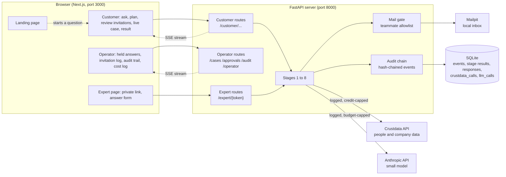
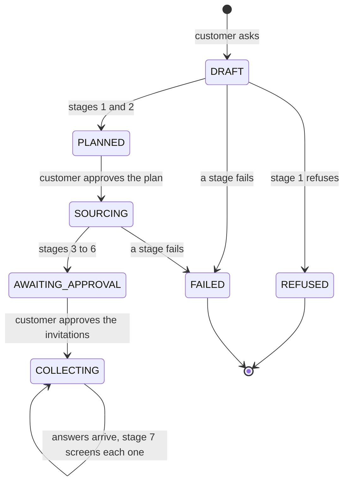
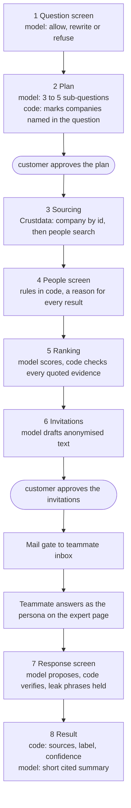

# Synex architecture

Diagrams are Mermaid, which GitHub renders in the browser. Everything shown here exists in the code.

## 1. System

One FastAPI process runs every stage, calls every outside service through a logging wrapper and writes everything to one SQLite file. The browser reads progress over one server-sent-events stream per case.

Customer routes never return a name, headline, profile link, city or email. Operator routes do, so they are separate and only the operator screens use them.

## 2. One case, start to finish

Two human clicks gate the irreversible steps: the plan approval starts spending Crustdata credits, and the invitation approval is what lets email leave (to a teammate allowlist only). Every state change is an audit event.

## 3. The eight stages

## 4. Where code decides and where the model decides

| Decision | Made by | Checked by |
| --- | --- | --- |
| Is the question allowed | small model | reason is shown; a refusal ends the case |
| Which companies were named in the question | code (whole-word match) | none needed |
| Which person fails the people screen | code, one function per rule | each result carries a reason |
| Which company record a name means | model chooses among ids Crustdata returned | code rejects an id that was not returned |
| How well a person fits | small model | code drops any quoted evidence that is not in the profile |
| Whether an answer is safe | small model proposes | code verifies quotes, holds on leak phrases, holds when the reply cannot be verified |
| How many independent sources | code, from work history | evidence is shown per group |
| Confidence | code (3 or more sources High, 2 Medium, 1 Low) | none needed |
| Agreement label and summary wording | small model | every sentence must cite an answer; code drops any that does not |

## 5. Data and the audit trail

- `events` is append-only and hash-chained: each row stores the previous row's hash and its own. `GET /audit/verify` recomputes the whole chain and names the first changed event.
- `crustdata_calls` and `llm_calls` are the cost log: every call, its purpose, its credits or tokens and its dollars. Prompts and responses are stored with each model call.
- `stage_results` and `responses` and `response_screens` are append-only too. A held answer is decided by adding a new row, never by editing text.
- SQLite triggers block UPDATE and DELETE on all of these tables.
